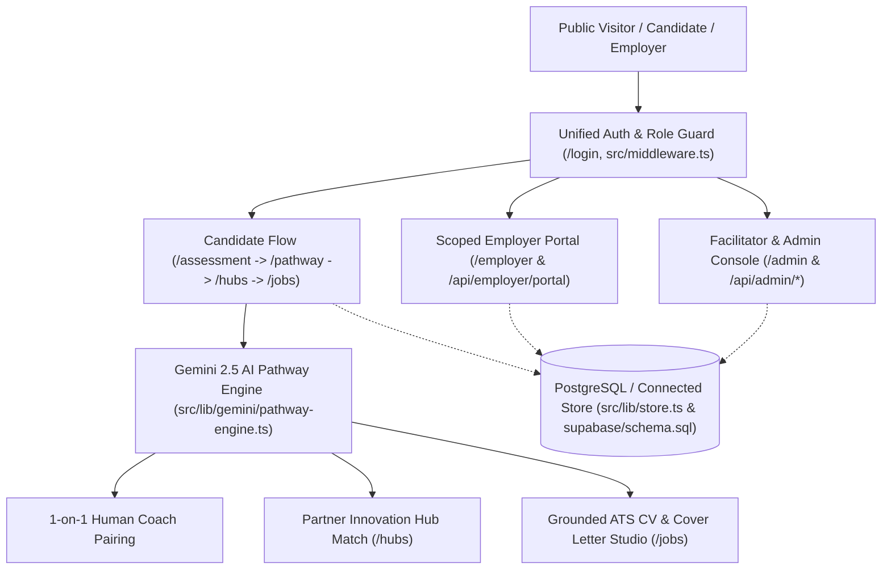

# Architecture & Team Development Guide

This document details how each module in `utare-zisedu-mvp` works and how team members collaborate cleanly across our platform pillars.

---

## 1. System Architecture Diagram



---

## 2. Detailed Documentation of Core Layers

### A. Unified Frontend Design System (`src/app/globals.css`, `styles.css`, `src/components/Navbar.tsx`)
Designed by **Faith Wenzira** and **Amanda**, the visual identity is integrated directly across all Next.js pages (`src/app/*`) as well as the standalone walkthrough (`/demo/index.html`):
- **Brand Identity & Typography:** Uses `Manrope` (headings) and `Inter` (body), deep navy (`#101a33`), emerald (`#0faf83` / `#08785f`), and soft slate (`#f5f8f8`), anchored by the `U` brand mark with its signature emerald dot.
- **Custom Illustrations:** CSS-rendered Zimbabwe (`ZW`) radial global-reach map on the Overview page (`/`) and orbital talent/skills/opportunity graphic on the split-screen Login/Register page (`/login`).
- **Interactive Page Templates:** Consistent `.page-hero` headers, `.journey-card` and `.journey-row` stages, `.values-band` mission/vision cards, `.team-grid` 6-person team showcase, 4-way `.filter-bar` on `/opportunities`, and interactive lesson progress modals on `/skills`.

### B. Authentication, Session Security & Role-Based Access (`src/lib/auth-session.ts`, `src/lib/auth-guard.ts`, `src/middleware.ts`)
- **Password Security (`src/lib/password-hash.ts`):** Hashes passwords with `PBKDF2-SHA256` (100,000 iterations, random 16-byte salt) and constant-time comparison.
- **Signed Sessions (`src/lib/auth-session.ts`):** Signs `HttpOnly`, `SameSite=Lax` cookies (`utare_session`) using Web Crypto `HMAC-SHA256` compatible with both Node.js API routes and Next.js Edge Middleware.
- **Strict Role Separation:**
  - `candidate`: Can complete diagnostics, generate AI pathways, reserve hub desks, tailor CVs, and apply to jobs.
  - `employer`: Self-registers with email confirmation; requires a one-time admin verification before posted roles publish publicly; views only applicants for their own jobs with private candidate fields stripped.
  - `admin` / `superuser`: Assigned strictly on the backend (via `SUPERUSER_EMAILS`/`ADMIN_EMAILS` env vars, the `/admin` **Team & User Roles** tab, or `scripts/manage-user.mjs`).

### C. Container & Database Persistence Layer (`supabase/schema.sql`, `src/lib/db.ts`, `src/lib/store.ts`)
- **`supabase/schema.sql`**: Defines 9 PostgreSQL tables (`innovation_hubs`, `coaches`, `candidate_profiles`, `skills_assessments`, `ai_career_pathways`, `remote_jobs`, `job_applications`, `employer_inquiries`, `contact_inquiries`) with seed data.
- **`src/lib/store.ts`**: Synchronizes state across PostgreSQL and a resilient file/in-memory store (automatically falling back to `/tmp` on read-only serverless platforms like Vercel).

### D. AI Pathway & Grounded Document Studio (`src/lib/gemini/pathway-engine.ts`, `src/lib/documents/*`)
- **`computeAssessmentScores(profile, quizAnswers)`**: Scores Domain Competency, Digital Readiness, Remote Work Literacy, and Infrastructure Index (`0–100`) and classifies candidates into `Market-Ready (Direct Placement)`, `Bridge-Ready (Hub + Rapid Upskilling)`, or `Foundation Track (Hardware Bridge + Intensive Coaching)`.
- **`generateAICareerPathway(profile, assessment)`**: Calls `@google/genai` (`gemini-2.5-flash`) with a structured schema and deterministic offline fallback.
- **Anti-AI-Slop Document Studio (`src/lib/documents/humanizer.ts`, `cv-writer.ts`, `cover-letter-writer.ts`, `docx-export.ts`)**: Generates grounded ATS CVs and Zimbabwean business application letters with `.docx` binary export.

---

## 3. Git Workflow for the Team

To prevent merge conflicts across Stewart, Faith, Amanda, Munashe, and Kudakwashe:

1. **Always pull latest `main` before starting work:**
   ```bash
   git checkout main
   git pull origin main
   ```
2. **Create a feature branch named after your task:**
   - Stewart: `git checkout -b feat/task-3-ai-coaching`
   - Faith: `git checkout -b feat/frontend-walkthrough-and-ui`
   - Amanda: `git checkout -b feat/ui-and-supabase-schema`
   - Munashe: `git checkout -b feat/task-4-hub-directory`
   - Kudakwashe: `git checkout -b docs/competitor-analysis-and-jobs`
3. **Run quality checks (`npm run lint && npm run typecheck && npm run test:ci && npm run build`) before committing.**
4. **Open a Pull Request into `main` on GitHub.**
