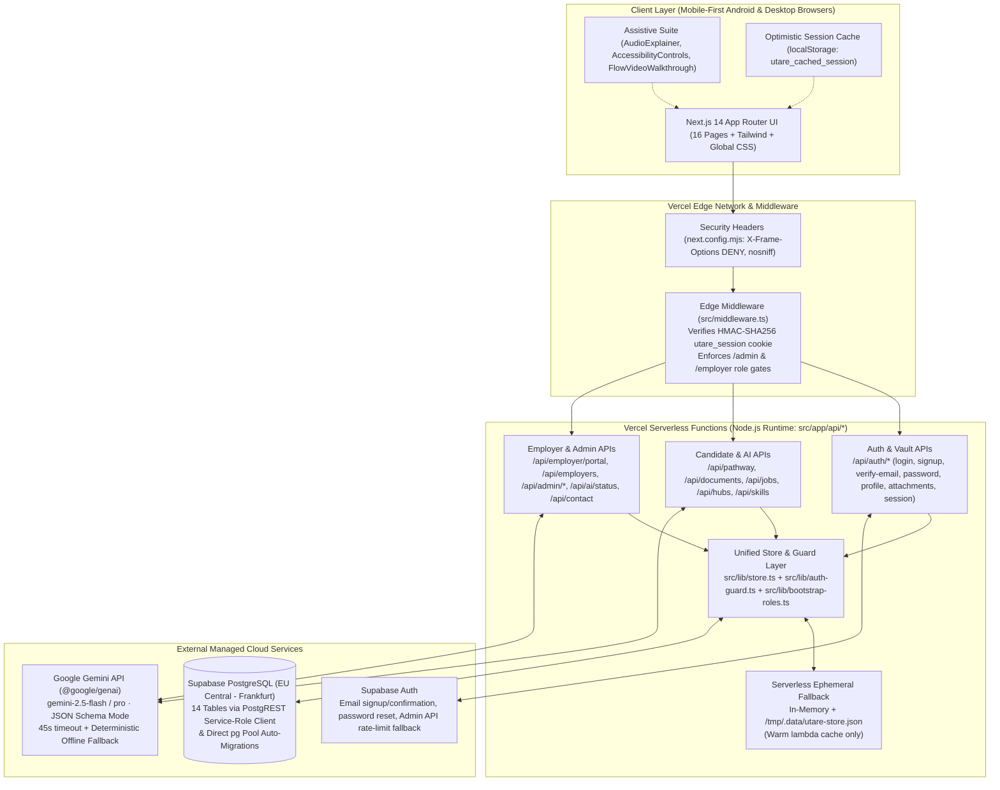
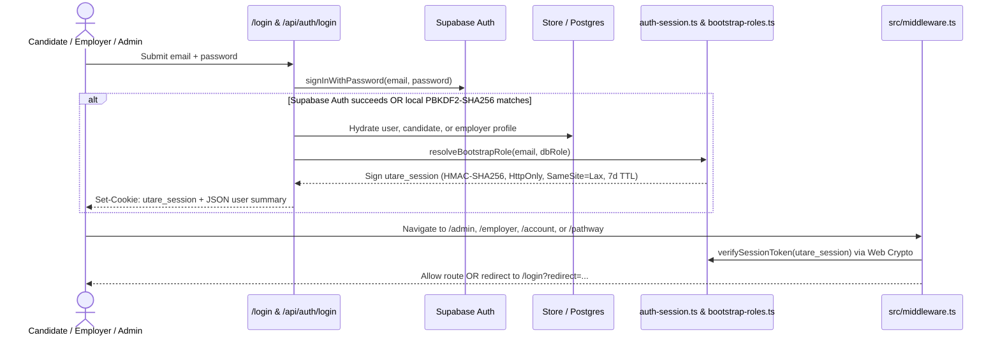

# UTARE ZEM AI — Full Application Architecture & Vercel Deployment Guide

This document provides the complete architectural layout of `utare-zisedu-mvp`—covering the frontend UI, Next.js App Router and API routes, Edge/Node authentication and RBAC, AI pathway & document studio engines, database persistence, and how the platform runs in **production on Vercel** alongside **local Docker**.

---

## 1. End-to-End System & Production Deployment Layout (Vercel + Supabase + Gemini)



### How the Pieces Fit Together at Runtime
1. **Browser → Vercel Edge:** Requests hit Vercel's CDN. Static assets and `/demo/index.html` serve from the edge, while security headers from `next.config.mjs` attach to every response.
2. **Edge Middleware (`src/middleware.ts`):** Intercepts `/admin/*`, `/employer/*`, `/account/*`, and `/pathway/*`. Using the Web Crypto API (`crypto.subtle` in `src/lib/auth-session.ts`), it verifies the `utare_session` HMAC-SHA256 cookie without needing a database roundtrip and blocks cross-role route access early.
3. **Node.js Serverless Functions (`src/app/api/*`):** Handle all dynamic business logic, AI generation, `.docx` export, password hashing, and database reads/writes.
4. **Cloud Persistence & AI:** On Vercel, persistent state lives in **Supabase (Auth + PostgreSQL)** accessed server-side via `SUPABASE_SERVICE_ROLE_KEY` (`getSupabaseServer()`), while AI synthesis runs against **Google Gemini 2.5** (`src/lib/gemini/client.ts`) with automatic deterministic fallback if the key is absent or a call times out.

---

## 2. Current Vercel Deployment Architecture & Serverless Lifecycle

Understanding how `utare-zisedu-mvp` runs on **Vercel (`utare-zisedu-mvp.vercel.app`)** is critical because serverless functions behave differently from a long-running VPS or Docker container.

### A. Build & Runtime Configuration
- **Framework:** Next.js `14.2.35` (`package.json`) with `output: "standalone"` in `next.config.mjs` (compatible with both Vercel builds and multi-stage Docker `Dockerfile` builds).
- **Execution Split:**
  - `src/middleware.ts` executes on the **Vercel Edge Runtime** (requires Web Crypto `crypto.subtle`, zero Node `fs` or `pg` imports).
  - Security-sensitive and database-backed routes (`src/app/api/auth/*`, `/api/admin/*`, `/api/employer/portal`, `/api/employers`) explicitly declare `export const runtime = "nodejs"` so they have access to Node `Buffer`, `crypto`, DNS MX lookups (`dns/promises`), `docx` binary generation, and `pg` connection pools.

### B. Serverless Cold-Start Hydration & Ephemeral Filesystem Handling
In `src/lib/store.ts`:
```text
IS_SERVERLESS = Boolean(process.env.VERCEL || process.env.AWS_LAMBDA_FUNCTION_NAME)
DATA_DIR      = IS_SERVERLESS ? "/tmp/.data" : "<repo>/.data"
```
1. **Why `/tmp/.data` alone is NOT durable on Vercel:**
   Vercel functions have a read-only deployment bundle and an ephemeral `/tmp` directory that is wiped on new deployments, function cold starts, or horizontal scaling across regions/lambdas.
2. **How the App Guarantees Durability on Vercel:**
   - **Service-Role Server Hydration (`getSupabaseServer()` in `src/lib/supabase/client.ts`):** All critical endpoints (`/api/auth/login`, `/api/auth/signup`, `/api/auth/session`, `/api/auth/profile`, `/api/auth/attachments`, `/api/pathway`, `/api/jobs`, `/api/hubs`, `/api/employers`, `/api/employer/portal`, `/api/admin/candidates`, `/api/admin/users`) use the **Supabase Service-Role client** (`SUPABASE_SERVICE_ROLE_KEY` / `SUPABASE_SECRET_KEY`), bypassing browser-side Row Level Security (RLS) on trusted server routes so cold-started lambdas immediately see all live records.
   - **Async DB Lookup Helpers (`findAuthUserByEmailFromDb`, `findCandidateByEmailAsync`, `findEmployerByEmailAsync`):** When a warm lambda cache (`inMemoryStore` / `/tmp/.data`) misses a user or candidate after a cold start, these helpers hydrate the record directly from Supabase Postgres and re-cache it in memory.
   - **Two-Way Persistence Sync:** Writes update the local/warm store (`writeStore`) and sync to Supabase PostgREST and/or direct PostgreSQL (`src/lib/db.ts`).
   - **Idempotent Auto-Migrations (`ensureDatabaseSchema()` in `src/lib/db.ts`):** When a direct Postgres connection string (`DATABASE_URL`, `POSTGRES_URL`, or `SUPABASE_DB_URL`) is configured, the first query per cold start runs non-destructive `CREATE TABLE IF NOT EXISTS` and `ALTER TABLE ... ADD COLUMN IF NOT EXISTS` statements so newly added tables (`candidate_documents`, `candidate_cv_artifacts`, `audit_logs`) and columns are always present without manual downtime.

### C. Origin Resolution & Email Confirmation on Vercel
In `src/app/api/auth/resend-confirmation/route.ts` and `src/app/api/auth/signup/route.ts`, confirmation redirect URLs (`<origin>/auth/callback`) dynamically resolve in priority order:
1. `origin` request header
2. `x-forwarded-host` + `x-forwarded-proto` headers (Vercel's reverse proxy headers)
3. `https://${process.env.VERCEL_URL}` (Vercel's built-in deployment host variable)
4. `NEXT_PUBLIC_APP_URL` → fallback `http://localhost:3000`

Additionally, if Supabase's free-tier email mailer hits its rate limit (`429` / `"rate limit"`), `/api/auth/signup` automatically falls back to `supabaseAdmin.auth.admin.createUser({ email_confirm: true })` so candidate and employer signups never stall during live demos or user testing.

### D. Vercel Environment Variables Reference
Configure these in **Vercel Dashboard → Project Settings → Environment Variables**:

| Variable | Required on Vercel? | Purpose |
| :--- | :---: | :--- |
| `NEXT_PUBLIC_SUPABASE_URL` | **Yes (Prod)** | Supabase project URL (`https://<ref>.supabase.co`) |
| `NEXT_PUBLIC_SUPABASE_ANON_KEY` *(or `NEXT_PUBLIC_SUPABASE_PUBLISHABLE_KEY`)* | **Yes (Prod)** | Public anon/publishable key for Supabase Auth client |
| `SUPABASE_SERVICE_ROLE_KEY` *(or `SUPABASE_SECRET_KEY`)* | **Yes (Prod)** | Server-only secret key for RLS-bypassed hydration & admin auth actions |
| `DATABASE_URL` *(or `POSTGRES_URL` / `SUPABASE_DB_URL`)* | Recommended | Direct Postgres connection string for `pg` Pool (`src/lib/db.ts`) & auto-migrations |
| `AUTH_SESSION_SECRET` | **Yes (Prod)** | Long random secret signing `utare_session` HMAC-SHA256 cookies across Edge & Node |
| `GEMINI_API_KEY` | Recommended | Google AI Studio key (`@google/genai`); falls back to deterministic engine if unset |
| `GEMINI_MODEL` | Optional | Defaults to `gemini-2.5-flash` (switchable to `gemini-2.5-pro` in `/admin`) |
| `SUPERUSER_EMAILS` | Recommended | Comma-separated emails automatically granted `superuser` role on signup/login |
| `ADMIN_EMAILS` | Optional | Comma-separated emails automatically granted `admin` role on signup/login |
| `NEXT_PUBLIC_APP_NAME` / `NEXT_PUBLIC_APP_URL` | Optional | App display name (`Utare ZEM AI`) and fallback public URL |

---

## 3. Authentication, Security & Role-Based Access Control (RBAC)



### Key Security Controls
- **Password Hashing (`src/lib/password-hash.ts`):** `PBKDF2-SHA256` with `100,000` iterations, random 16-byte salt, and constant-time comparison (`crypto.timingSafeEqual`).
- **Validation & Anti-Fake-Domain Guard (`src/lib/validation.ts`, `src/lib/email-domain-check.ts`):** Rejects malformed emails, disposable email providers, and domains without valid DNS MX records during registration.
- **Role Hierarchy (`src/types/index.ts`, `src/lib/auth-guard.ts`):**
  - `candidate`: Completes 6-factor diagnostic, generates AI pathway, reserves hub desks, uploads versioned credentials, generates tailored CVs/cover letters, applies to jobs.
  - `employer`: Self-registers with company details; requires **one-time admin verification** before posted roles appear publicly; `/api/employer/portal` strictly scopes applicants to the employer's own jobs and strips private candidate fields (phone, income bracket, hardware deficits, internal diagnostic scores) via `toEmployerApplicantView()`.
  - `admin` / `superuser`: Provisioned strictly on the backend (`SUPERUSER_EMAILS`, `ADMIN_EMAILS`, `DEFAULT_BOOTSTRAP_SUPERUSERS` in `src/lib/bootstrap-roles.ts`, `/admin` **Team & User Roles** tab, or `scripts/manage-user.mjs`).

---

## 4. Core Functional Engines

### A. 6-Factor Diagnostic & AI Career Pathway (`src/lib/gemini/pathway-engine.ts`)
1. **`computeAssessmentScores(profile, quizAnswers)`**: Computes four `0–100` indices (*Domain Competency*, *Digital Readiness*, *Remote Work Literacy*, *Infrastructure Index*) and classifies the candidate into:
   - `Market-Ready (Direct Placement)`
   - `Bridge-Ready (Hub + Rapid Upskilling)`
   - `Foundation Track (Hardware Bridge + Intensive Coaching)`
2. **`generateAICareerPathway(profile, assessment)`**:
   - Calls `generateJson()` (`src/lib/gemini/client.ts`) with strict Gemini JSON `responseSchema`, `45s` timeout, and `temperature: 0.7`.
   - Generates a **90-day roadmap** split into 3 consecutive 30-day phases (*Foundation*, *Specialization*, *Market Placement*) plus targeted weekly actions and mentor agenda items.
   - If Gemini is unconfigured, times out, or fails on poor connectivity, seamlessly falls back to a deterministic survey-grounded roadmap.
3. **Physical & Human Matching:** `matchNearestHub(city)` pairs the candidate to the closest solar/Starlink hub (`SEED_INNOVATION_HUBS`), and `matchBestCoach(fieldOfStudy)` pairs them with a Zimbabwean/diaspora mentor (`SEED_COACHES` with Cal.com booking).

### B. Anti-AI-Slop Grounded Document Studio (`src/lib/documents/*`)
- **`cv-writer.ts` & `cover-letter-writer.ts`:** Synthesizes ATS-compliant CVs and formal Zimbabwean business application letters grounded strictly in candidate-provided credentials, education, and target role facts (zero fabricated employers or dates).
- **`humanizer.ts`:** Scans generated text against **45+ banned AI clichés** (e.g., *"spearheaded synergies"*, *"fast-paced world"*), computes a `0–100` natural human tone score, and strips robotic phrasing.
- **`docx-export.ts`:** Exports ready-to-send **Word (`.docx`)** binaries using the `docx` library (embedding the candidate's portrait via `ImageRun` when `includePhotoOnCv` is enabled).
- **Versioning (`candidate_cv_artifacts`):** Every generated CV & cover letter pair is persisted with auto-incrementing version numbers (`v1`, `v2`, ...).

### C. AI Applicant Fit Ranking & Audit Trail (`src/lib/store.ts`)
- **`evaluateApplicantFit()`:** Automatically scores every job application (`0–100% AI Fit`), assigns a tier (`Top Match (Recommended)`, `Strong Contender`, `Developing Fit`), lists matched skills, and generates tailored interview questions for the Employer Portal (`/employer`).
- **`recordAuditLog()` (`audit_logs` table):** Records immutable traceability entries whenever application statuses change, roles are promoted/demoted, passwords are reset, jobs are posted, or credentials/CV artifacts are saved.

### D. Inclusivity, Accessibility & Brand Visuals (`src/components/*`)
- **`<ZimbabweMapGraphic />`:** Custom SVG vector map of Zimbabwe's 10 provinces with pulsing radar beacons for Harare, Bulawayo, and Mutare hubs.
- **`<FlowVideoWalkthrough />` & `<WatchDemoButton />`:** Interactive 5-step visual demo modal with auto-advance, playback speed, Closed Captions (CC), and pitch video embed support.
- **`<AudioExplainer />`:** Zero-bandwidth Web Speech API narration (4 chapters in warm conversational tone with voice prioritization and transcript).
- **`<AccessibilityControls />` & `<AssistiveToolbar />`:** Floating WCAG AAA High Contrast toggle, Deuteranopia/Protanopia/Tritanopia colorblind filters, font scaling, dyslexia spacing, and screen-reader outline announcer.
- **`<PageBreadcrumb />`:** Persistent sub-navigation bar with smart `← Back` fallback and directional next-step journey links.

---

## 5. Complete Application Surface Map

### A. Next.js App Router Pages (`src/app/*/page.tsx` — 16 Routes)

| Route | Role / Access | Primary Purpose |
| :--- | :--- | :--- |
| `/` | Public | Executive Overview, Zimbabwe map radar, empirical survey metrics ($N=23$), 4-stage journey, and Demo launcher |
| `/about` | Public | *"Six young people, one shared challenge"* story, Mission/Vision/Proposal, and 6-person team roster |
| `/how-it-works` | Public | Interactive 4-stage mobility walkthrough linking directly into live modules |
| `/opportunities` | Public | 4-way filterable remote/hybrid/local opportunity explorer with detail modal & CV Studio handoff |
| `/skills` | Public | Modular skills development courses with interactive lesson progress modal |
| `/employers` | Public | Employer overview & self-registration / inquiry form |
| `/contact` | Public | General, Hub, and Partner inquiry form backed by `/api/contact` |
| `/login` | Public | Split-screen Sign In, Candidate/Employer Registration, and Forgot/Reset Password flow |
| `/auth/callback` | Public | Supabase / email verification callback handler |
| `/assessment` | Candidate | Smart Intake, 6-Factor Readiness Diagnostic, and Coach/Hub pairing |
| `/pathway` | Candidate | Interactive 90-Day AI Career Roadmap, milestone tracker, and mentor session booking |
| `/hubs` | Candidate / Public | Partner Innovation Hub directory (Harare, Bulawayo, Mutare, Gweru, Masvingo, Chinhoyi) & desk booking |
| `/jobs` | Candidate | Verified Remote Jobs + Grounded ATS CV & Application Letter Studio + `.docx` / PDF export |
| `/account` | Candidate | Personal dashboard, profile photo upload, versioned Credential Vault, CV artifact history, password update, and application tracker |
| `/employer` | Employer / Admin | Scoped Employer Portal: post/archive roles, attach role docs/links, inspect AI-ranked applicants, and update hiring status |
| `/admin` | Admin / Superuser | Facilitator Operations Console: verify employers, AI job discovery & approval, hub enlistment, candidate quick-info inspection, user role management, Gemini diagnostics, and audit log viewer |

*(Plus the preserved standalone static walkthrough at `public/demo/index.html` → `/demo/index.html` and root `index.html`.)*

### B. REST API Routes (`src/app/api/*` — 22 Endpoints)

| Endpoint | Methods | Auth Guard | Responsibility |
| :--- | :--- | :--- | :--- |
| `/api/auth/signup` | `POST` | Public | Validates email + MX domain + password strength; creates user in Supabase Auth (with Admin rate-limit fallback) & local/Postgres store |
| `/api/auth/login` | `POST` | Public | Verifies Supabase Auth or PBKDF2 hash; resolves bootstrap role; issues signed `utare_session` cookie |
| `/api/auth/logout` | `POST` | Session | Signs out Supabase session and clears `utare_session` cookie |
| `/api/auth/session` | `GET` | Optional | Returns current authenticated user hydrated from candidate/employer DB tables |
| `/api/auth/verify-email` | `GET`, `POST` | Public | Verifies email OTP / confirmation token and signs session cookie |
| `/api/auth/resend-confirmation` | `POST` | Public | Resends verification email with dynamically resolved Vercel/host origin |
| `/api/auth/password` | `POST` | Session / Admin / Reset | Self-service password change, forgot-password reset, or admin override |
| `/api/auth/profile` | `GET`, `POST`, `PATCH` | Session | Reads/updates candidate profile, photo (`avatarDataUrl`), and `includePhotoOnCv` |
| `/api/auth/attachments` | `GET`, `POST`, `DELETE` | Session | Manages versioned `candidate_documents`, `candidate_cv_artifacts`, and `audit_logs` |
| `/api/pathway` | `GET`, `POST`, `PATCH` | Optional / Session | Runs 6-factor scoring + Gemini 90-day pathway generation + milestone/coach progress updates |
| `/api/documents` | `POST` | Public / Session | Generates grounded CV + cover letter JSON, runs anti-slop audit, saves versioned artifact, or streams `.docx` binary |
| `/api/jobs` | `GET`, `POST` | Public (`GET`) / Session (`POST`) | Lists approved jobs (all for admins) and submits candidate job applications with AI fit scoring |
| `/api/hubs` | `GET`, `POST` | Public (`GET`) / Session (`POST`) | Lists Zimbabwe partner hubs from Supabase/store and books candidate hub desks |
| `/api/skills` | `GET` | Public | Returns modular skills courses (`SEED_SKILLS_COURSES`) |
| `/api/employers` | `GET`, `POST`, `PATCH` | Admin (`GET`/`PATCH`) / Public (`POST`) | Handles employer partner registrations and admin verification status updates |
| `/api/employer/portal` | `GET`, `POST`, `PATCH`, `DELETE` | Employer / Admin | Scoped job posting/archiving and candidate status updates (`under_review`, `shortlisted`, `rejected`, `hired`) |
| `/api/admin/candidates` | `GET` | Admin / Superuser | Hydrates and returns full candidate cohort, assessments, and applications |
| `/api/admin/hubs` | `GET`, `POST`, `DELETE` | Public (`GET`) / Admin | Lists, adds, and removes partner innovation hubs |
| `/api/admin/jobs` | `GET`, `POST`, `PATCH`, `DELETE` | Admin / Superuser | Runs Gemini AI remote job discovery, manual job creation, approval, and deletion |
| `/api/admin/users` | `GET`, `POST`, `PATCH` | Admin / Superuser | Lists users and promotes/demotes user roles (`superuser` gated for admin/superuser changes) |
| `/api/ai/status` | `GET`, `POST` | Public (`GET`) / Admin | Checks Gemini configuration, pings live model latency (`?ping=1`), and updates active model |
| `/api/contact` | `POST` | Public | Saves contact & partnership inquiries to `contact_messages` |

### C. PostgreSQL & Supabase Schema (`supabase/schema.sql` & `src/lib/db.ts` — 14 Tables)
1. `auth_users` — Account credentials (`password_hash`), backend-enforced `role`, `email_confirmed`, `employer_id`, `avatar_data_url`
2. `innovation_hubs` — Partner co-working nodes (city, kVA solar capacity, Starlink speed, workstation capacity, loaner laptop pool)
3. `coaches` — Human mentors & Cal.com booking links
4. `candidate_profiles` — Candidate intake demographics, hardware/power/connectivity readiness, `avatar_data_url`, `include_photo_on_cv`
5. `skills_assessments` — 4-dimension scores (`0–100`) and readiness tier classification
6. `ai_career_pathways` — Generated 90-day phases, weekly milestones, matched hub, and matched coach
7. `remote_jobs` — Curated & employer-posted roles, payment rails, approval status, `company_website`, `external_role_url`, `attachment_documents`
8. `job_applications` — Candidate applications, tailored CV/cover letter snapshots, `attached_document_ids`, `status`, `status_history`
9. `employer_registrations` — Company profile, verification status (`pending`/`verified`/`rejected`), `career_page_url`, `shared_documents`
10. `skills_courses` — Modular upskilling catalog
11. `contact_messages` — Contact & partnership inquiries
12. `candidate_documents` — Versioned degrees, transcripts, certificates, and portfolios (`version`, `is_latest`)
13. `candidate_cv_artifacts` — Versioned tailored CV & application letter history linked to jobs
14. `audit_logs` — Immutable platform activity trail (`actor_email`, `actor_role`, `entity_type`, `action`, `summary`)

---

## 6. Local Docker vs. Vercel Production Parity

| Dimension | Local Docker (`docker compose up -d --build`) | Vercel Production (`utare-zisedu-mvp.vercel.app`) |
| :--- | :--- | :--- |
| **Compute** | Single container `utare-zisedu-web` (`node:20-alpine`, `Dockerfile.dev`) | Vercel Edge Middleware + Stateless Node.js Serverless Functions |
| **Primary Database** | `utare-zisedu-db` (`postgres:16-alpine` on port `5432`, volume `utare_pgdata`) | Cloud **Supabase PostgreSQL (EU Central - Frankfurt)** |
| **Fallback Store** | `<repo>/.data/utare-store.json` (persistent on host disk) | `/tmp/.data/utare-store.json` + in-memory cache (**ephemeral**; Supabase required for persistence) |
| **Schema Updates** | Initialized by `supabase/schema.sql` + additive `ensureDatabaseSchema()` | Run `supabase/schema.sql` in Supabase SQL Editor + additive `ensureDatabaseSchema()` |
| **Data Safety Rule** | **Never** run `docker compose down -v` (preserves `utare_pgdata`) | **Never** run `DROP`/`TRUNCATE`; use additive migrations only |

---

## 7. Team Ownership & Git Collaboration Workflow

### Current Team Roster & Domain Ownership (`src/app/about/page.tsx`)
- **Munashe Mugonda** (*Team Lead · Candidate Intake & Partner Hubs*): Overall team coordination, candidate diagnostic intake workflows, and partner hub mapping across Zimbabwe.
- **Stewart Mangezi** (*Platform Architecture & AI Engine*): Candidate accounts, 6-factor diagnostics, Gemini AI pathway engine, auth/security, Docker, and Vercel/Supabase deployment.
- **Future** (*Frontend Experience, UI & User Testing*): Visual identity, interactive candidate journey, opportunities explorer, accessibility feedback, and mobile user testing.
- **Amanda Mukute** (*Frontend Architecture & Database*): Frontend UI design, UX polish, partner hub layouts, and PostgreSQL / Supabase schema structure.
- **Kudakwashe Maganzu** (*Market Validation & Remote Jobs*): Competitor analysis, market validation, anti-scam verification criteria, and remote job/payment rail curation.
- **Bheki Ndlovu** (*Storytelling, Strategy & Partnerships*): Strategic ecosystem partnerships, sustainable business model, empirical journey storytelling, and employer/mentor outreach.

### Git Branch & CI Checklist
1. **Pull latest `main`:**
   ```bash
   git checkout main
   git pull origin main
   ```
2. **Create a feature branch:**
   ```bash
   git checkout -b feat/<short-task-name>
   ```
3. **Run full local quality gates before opening a PR (matches `.github/workflows/ci.yml`):**
   ```bash
   npm run lint && npm run typecheck && npm run test:ci && npm run build
   ```
   *(Or inside Docker: `make ci-local`.)*
4. **Open a Pull Request into `main` on GitHub** (automated CI runs ESLint, `tsc --noEmit`, all 8 Vitest suites in `src/__tests__/`, and `next build`).
