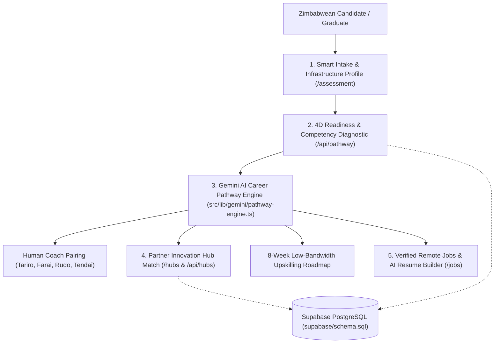

# Architecture & Team Development Guide

This document details how each module in `utare-zisedu-mvp` works and how team members can collaborate cleanly across our 5 MVP pillars.

---

## 1. System Architecture Diagram



---

## 2. Detailed Documentation of Core Files

### A. Container & Configuration Layer
- **`Dockerfile.dev`**: Development image using `node:20-alpine`. Sets `WATCHPACK_POLLING=true` so file changes made on macOS or Windows trigger Next.js Fast Refresh immediately inside Linux containers.
- **`Dockerfile`**: Production multi-stage Dockerfile (`deps` → `builder` → `runner`) configured with Next.js `output: "standalone"` for lightweight cloud deployment (Cloud Run, Railway, Render, or Fly.io).
- **`docker-compose.yml`**: Maps port `3000:3000`, loads `.env.local`, mounts the repository into `/app`, and keeps `node_modules` isolated in a named volume.

### B. Database Layer (`supabase/schema.sql` & `src/lib/supabase/client.ts`)
- **`supabase/schema.sql`**: Defines 6 PostgreSQL tables:
  1. `innovation_hubs`: Solar backup status, Starlink/Fiber speeds, workstation counts, and laptop loan availability.
  2. `coaches`: Industry mentors mapped by specialty track and weekly availability.
  3. `candidate_profiles`: Stores qualification, field of study, current employment alignment, income bracket, and infrastructure constraints (`has_dedicated_laptop`, `internet_access_type`, `power_reliability_hours`, `has_global_payment_rail`).
  4. `skills_assessments`: Stores 0–100 scores across Domain Competency, Digital Readiness, Remote Work Literacy, and Infrastructure Index.
  5. `ai_career_pathways`: Stores the Gemini-generated roadmap, paired `assigned_coach_id`, and `recommended_hub_id`.
  6. `remote_jobs`: Verified remote opportunities with `supported_payment_rails`.
- **`src/lib/supabase/client.ts`**: Exports `supabase` and `isSupabaseConfigured`. Automatically detects whether `.env.local` has valid Supabase keys and falls back to seed data if not configured yet.

### C. Task #3: AI Pathway & Human Coach Pairing (`src/lib/gemini/pathway-engine.ts`)
- **`computeAssessmentScores(profile, quizAnswers)`**:
  - Calculates the 4 readiness scores and classifies the candidate into one of three tiers:
    - `Market-Ready (Direct Placement)`
    - `Bridge-Ready (Hub + Rapid Upskilling)`
    - `Foundation Track (Hardware Bridge + Intensive Coaching)`
- **`matchNearestHub(city)`**:
  - Pairs the candidate with the closest solar/Starlink Partner Innovation Hub (Harare, Bulawayo, Mutare, Gweru) to solve their power or laptop deficit.
- **`matchBestCoach(profile)`**:
  - Pairs the candidate with the right Zimbabwean human mentor based on their degree and goal (e.g., Eng. Farai Ncube for STEM/CS, Tariro Moyo for Operations/Humanities, Rudo Chikwanda for Finance/Payment Rails, Tendai Mutasa for Grassroots SMEs).
- **`generateAICareerPathway(profile, assessment)`**:
  - Calls Google's `@google/genai` SDK (`gemini-2.5-flash`) with a structured JSON prompt tailored to Zimbabwe's economic mobility context. Includes an automatic deterministic fallback if `GEMINI_API_KEY` is not set.

---

## 3. Git Workflow for the Team

To prevent merge conflicts across Stewart, Munashe, Amanda, and Kudakwashe:

1. **Always pull latest `main` before starting work:**
   ```bash
   git checkout main
   git pull origin main
   ```
2. **Create a feature branch named after your task:**
   - Stewart: `git checkout -b feat/task-3-ai-coaching`
   - Munashe: `git checkout -b feat/task-4-hub-directory`
   - Amanda: `git checkout -b feat/ui-and-supabase-schema`
   - Kudakwashe: `git checkout -b docs/competitor-analysis-and-jobs`
3. **Test inside the Docker container (`docker compose up --build`) before committing.**
4. **Open a Pull Request into `main` on GitHub.**
