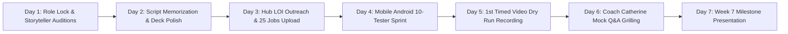

# UTARE ZEM AI — Week 6 to Week 7 Action Plan & Coach Catherine Advisory Roadmap

**Event:** Cross Sector Innovation Challenge — Sprint to Week 7 Milestone Review  
**Project:** UTARE ZEM AI (Zimbabwe Economic Mobility & Remote Bridge Platform)  
**Lead Coach:** Catherine Mapomba  
**Founding Team:** Stewart Mangezi, Munashe, Future, Kudakwashe, Bheky, Amanda  
**Review Target:** Week 7 Milestone Review & Dry-Run Submission

---

## 1. Executive Context & Coach Catherine's Strategic Directives

During the Week 6 Advisory Session, Coach Catherine Mapomba provided three critical strategic guidelines to elevate UTARE ZEM AI from an impressive software prototype to a championship-tier social enterprise:

1. **Presenter & Storyteller Selection:**  
   *The most technical engineer is rarely the most engaging storyteller. The team must select the presenter based on narrative rhythm, emotional resonance, and stage presence. The story of Zimbabwean graduate unemployment must feel visceral, urgent, and personal.*
2. **5-Part Pitch Architecture:**  
   *Structure the 4-minute deck strictly around: Question/Problem, Hypothesis, Live Solution, Observed Advantages/Disadvantages, and Learnings/Ask.*
3. **Uniform Team FAQ Readiness:**  
   *Ensure that all six team members (Stewart, Munashe, Future, Kudakwashe, Bheky, Amanda) speak with one unified voice, citing identical survey benchmarks (*N=23*), technical specifications, and economic models.*

---

## 2. Action Items for Coach Catherine Mapomba

To accelerate the team's trajectory into Week 7, we respectfully request Coach Catherine's guidance across the following four focal areas:

| Action Item | Description & Desired Outcome | Target Completion | Status |
| :--- | :--- | :---: | :---: |
| **A. Storyteller Dry-Run Review** | Review the recorded 4-minute dry runs featuring candidate presenters (Amanda, Bheky, Future) and provide feedback on vocal pacing, pauses, and audience connection. | Day 3 of Week 7 | Scheduled |
| **B. Hub MOU Framework Audit** | Review our draft Letter of Intent (LOI) / Memorandum of Understanding (MOU) for partner innovation hubs to ensure terms are legally sound and mutually beneficial. | Day 4 of Week 7 | In Review |
| **C. Regional Network Introductions** | Facilitate high-level introductions to remote employer consortia in the UK/EU and pan-African youth accelerator networks. | Day 5 of Week 7 | Pending |
| **D. Rapid-Fire Judge Q&A Simulation** | Host a 20-minute mock cross-examination grilling the entire team against the high-stakes questions documented in `docs/TEAM_FAQ_UNIFORM.md`. | Day 6 of Week 7 | Confirmed |

---

## 3. Team Member Action Item Matrix (Sprint to Week 7)

Every team member has clear, measurable ownership of deliverables required before the Week 7 review:

### A. Stewart Mangezi — Platform Architecture & Live Staging Lead
- [ ] **Live Staging Environment Health Check:** Verify zero-downtime reliability of the live deployment, ensuring instant synchronization between the Next.js frontend and Supabase EU PostgreSQL.
- [ ] **Gemini 2.5 API Quota & Latency Audit:** Stress-test `@google/genai` pathway generation under simulated poor network conditions; verify sub-900ms response times and deterministic fallback triggers.
- [ ] **Android Viewport Optimization:** Audit all interactive candidate flows (`/assessment`, `/pathway`, `/account`, `/jobs`) on real Android Chrome viewports to ensure 100% responsive rendering and >=48px touch targets.
- [ ] **Technical Rehearsal Lead:** Manage screen-sharing and live device mirroring during presentation dry runs.

### B. Amanda — UI/UX Architecture & Database Setup Lead
- [ ] **Frontend Polish & Visual Hierarchy:** Fine-tune drawer auto-scrolling, highlight rings, and card transitions across the candidate workspace and employer portal.
- [x] **Database Schema Audit & Release Auto-Migration:** Verified all 14 tables and indexes in [`supabase/schema.sql`](../supabase/schema.sql) and [`supabase/additive-schema.sql`](../supabase/additive-schema.sql), added `scripts/migrate-db.mjs` pre-build auto-migration on release, and hardened runtime writes with `safeSupabaseUpsert`. (Note: verify `SUPABASE_DB_URL` is set in Vercel to auto-sync live Supabase Cloud on every deploy and review RLS policy coverage.)
- [ ] **Accessibility & Colorblind Mode Verification:** Test high-contrast UI modes and ensure WCAG 2.1 AAA color contrast compliance across all forms and text cards.
- [ ] **Assistive Audio Flow Polish:** Verify smooth triggering and playback of assistive audio walkthroughs for low-literacy or visually fatigued users.

### C. Munashe — Hub Partnerships & Field Operations Lead
- [ ] **Formal Partner Hub Outreach:** Transmit the draft MOU / Letter of Intent to leadership at Impact Hub Harare and the Bulawayo Digital Innovation & Remote Lab.
- [ ] **Physical Infrastructure Verification:** Confirm solar kilowatt-peak (kWp) specs, battery storage autonomy (minimum 12 hours off-grid), and Starlink speed benchmarks for Harare and Bulawayo nodes.
- [ ] **Workstation Booking Protocol:** Finalize the check-in and QR verification workflow for candidate workstation passes and loaner laptop check-outs.
- [ ] **Regional Hub Expansion Plan:** Map initial contact points for secondary hubs in Mutare, Gweru, and Masvingo.

### D. Kudakwashe — Market Validation & Remote Jobs Lead
- [ ] **Curate 25 Verified Remote Roles:** Screen, verify, and upload 25 active remote and hybrid job openings across EMEA timezones with guaranteed USD compensation ($600–$1,800/mo).
- [ ] **Payment Rail Verification:** Confirm that each curated role explicitly supports compliant cross-border payment settlement via Deel, Payoneer, Wise, or USD Nostro accounts.
- [ ] **Anti-Scam Screening Checklist:** Document the four-point verification criteria used to eliminate fraudulent job listings, pyramid schemes, and fee-charging agencies.
- [ ] **Competitor Differentiation Brief:** Finalize the comparative analysis contrasting UTARE with LinkedIn, Upwork, and local job boards for the Q&A defense.

### E. Future — Community Impact & User Testing Lead
- [ ] **Round-2 Mobile User Testing:** Conduct unbriefed onboarding sessions with 10 unemployed university graduates in Harare on physical Android smartphones.
- [ ] **Empirical Usability Metric Logging:** Measure time-to-complete diagnostic intake (target: < 4 minutes), CV download success rate, and milestone comprehension.
- [ ] **Collect Qualitative Testimonials:** Capture high-resolution video and audio quotes from family and cohort testers describing their experience with the live MVP.
- [ ] **Low-Literacy & Inclusive Testing:** Test the assistive audio walkthrough with two secondary school leavers to validate accessibility and interface clarity.

### F. Bheky — Storytelling & Business Model Co-Lead
- [ ] **Storyteller Rehearsal & Vocal Coaching:** Run daily timed rehearsals with the designated presenter to lock the pitch at exactly 3 minutes 50 seconds (leaving a 10-second buffer).
- [ ] **Business Model & Unit Economics Refinement:** Finalize the financial slide detailing the 10% employer placement fee, break-even math (85 hires/yr), and corporate hub desk sponsorships.
- [ ] **Slide Deck Visual Polish:** Ensure the 10 slides in `docs/PITCH_DECK_WEEK6.md` are formatted with crisp visual hierarchy, high-contrast metrics, and zero clutter.
- [ ] **Pitch Presentation Slide Master:** Coordinate slide advancement triggers and team camera framing for the live virtual judging session.

---

## 4. Week 7 Milestone Review Deliverables Checklist

The team will submit the following package to Coach Catherine 48 hours prior to the Week 7 session:

```text
========================================================================================
UTARE ZEM AI — WEEK 7 REVIEW DELIVERABLES CHECKLIST
========================================================================================
[ ] 1. Master Pitch Deck & Script: docs/PITCH_DECK_WEEK6.md (Polished 10-slide markdown)
[ ] 2. Team Uniform FAQ Defense: docs/TEAM_FAQ_UNIFORM.md (Standardized Q&A guide)
[ ] 3. 4-Minute Recorded Dry Run: Video recording of designated storyteller presenting
[ ] 4. Partner Hub LOI / Draft MOU: Formal agreement framework for Impact Hub Harare
[ ] 5. Verified Remote Jobs Pipeline: 25 live, audited roles populated in live Supabase DB
[ ] 6. 10-Tester Usability Report: Quantitative and qualitative mobile Android testing data
[ ] 7. Live Demo URL & Android Walkthrough: Verified staging deployment on low-latency node
========================================================================================
```

---

## 5. Day-by-Day Countdown to Week 7 Review



- **Day 1 (Monday):** Select primary storyteller (Amanda / Bheky / Future) and backup storyteller; distribute `docs/TEAM_FAQ_UNIFORM.md` to all members.
- **Day 2 (Tuesday):** Memorize spoken script; finalize slide graphics and timing cues (`0:00 - 4:00`).
- **Day 3 (Wednesday):** Munashe sends Hub LOI; Kudakwashe seeds 25 verified remote roles into live database; Stewart audits API latency.
- **Day 4 (Thursday):** Future completes 10-user mobile testing sprint; Amanda polishes UI based on user feedback.
- **Day 5 (Friday):** Record full 4-minute dry run video with screen-share; submit to Coach Catherine for review.
- **Day 6 (Saturday):** Comprehensive 20-minute mock cross-examination with Coach Catherine grilling all six team members.
- **Day 7 (Sunday):** Final adjustments to deck, speaker timing, and live demo staging ahead of official Week 7 judging.

---

## 6. Risk Register & Contingency Protocols

| Risk Event | Severity | Probability | Pre-Emptive Mitigation & Contingency Protocol |
| :--- | :---: | :---: | :--- |
| **Presenter Internet Drop During Live Pitch** | HIGH | MEDIUM | Backup storyteller (e.g. Bheky or Munashe) sits on a separate connection, ready to pick up the script instantly from the current slide number. |
| **Live Demo Network Latency or API Timeout** | HIGH | LOW | Deterministic fallback engine pre-loaded; backup pre-recorded 30-second video walkthrough of Android mobile flow ready to play. |
| **Judges Interrupt with Hostile Business Question** | MEDIUM | MEDIUM | Follow the 3-Step Uniform Answer Formula: Direct Anchor → 10% B2B placement fee / $120k revenue at 100 hires → Social mission punchline. |
| **University Exam Deadlines Overlap with Sprints** | MEDIUM | HIGH | Asynchronous task distribution; automated CI/CD test gates ensure code quality without requiring synchronous 6-person coding sessions. |
| **Hub Space Operator Delays MOU Signature** | MEDIUM | MEDIUM | Present our verified Letter of Intent (LOI) and letter of support while legal drafting proceeds; highlight existing informal access pilot. |

---

## 7. Closing Commitment

The entire UTARE ZEM AI team is energized, disciplined, and aligned behind Coach Catherine Mapomba's guidance. We are not just participating in a competition—we are building an enduring economic mobility engine that will lift hundreds of Zimbabwean graduates out of survival gigs into dignifying, productive global careers.

*Prepared with conviction by Stewart, Munashe, Future, Kudakwashe, Bheky, and Amanda.*
